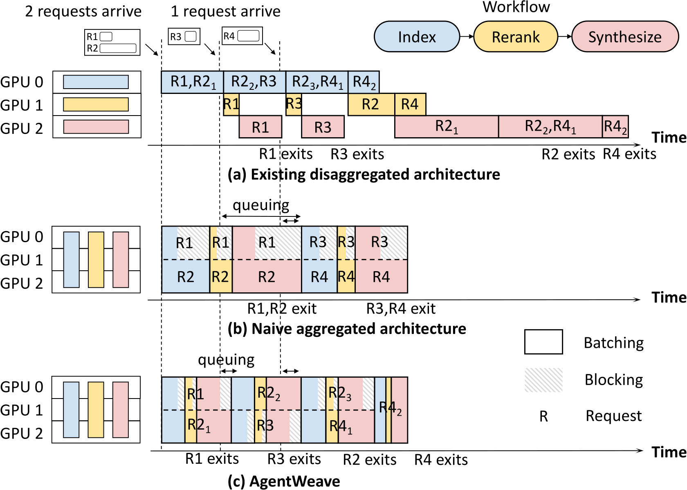
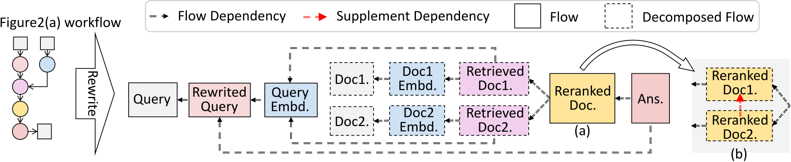
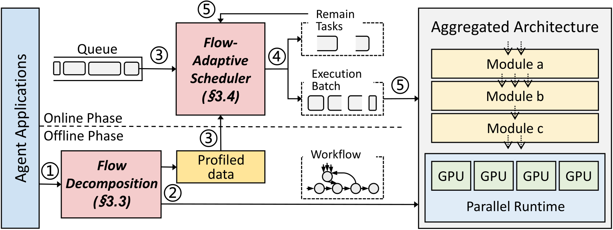
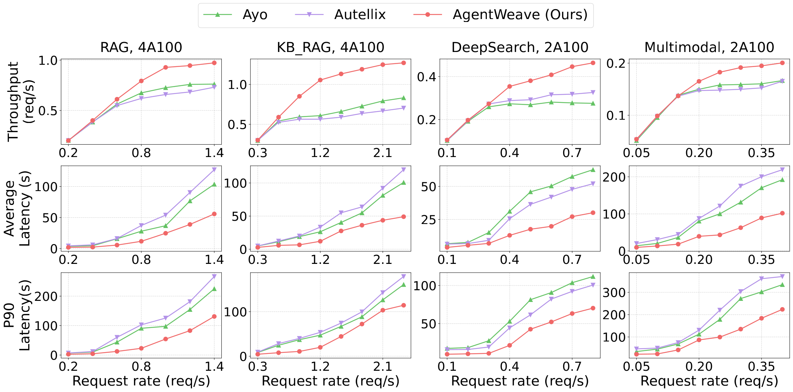

# AgentWeave

**Efficient Distributed Agent Serving via Flow Decomposition**\
*NeurIPS 2026 · Main Track Poster*

Kaibin Guo, Pengtu Li, Zicong Hong, Zhiyuan Fang, Wuhui Chen, Rachid Guerraoui, and Anne-Marie Kermarrec\
Sun Yat-sen University · EPFL

[Paper](https://arxiv.org/abs/2610.14804) · [Method](#method) · [Performance](#performance) · [Quick Start](#quick-start) · [Citation](#citation)

AgentWeave serves agent workflows composed of large language model (LLM) calls and tool invocations, termed *modules*. It adopts an *aggregated* architecture and addresses its key challenge, *request blocking*, through decomposition. It exposes *flow* as the decomposition unit and deploys *flow decomposition* to safely decompose a request. It also deploys a *flow-adaptive scheduler* to balance decomposition gains against overhead. Across four agent applications, AgentWeave achieves **1.28–1.81× the throughput**, with **2.08–2.45× lower average latency** and **1.56–2.04× lower P90 latency**.

## Introduction

Existing disaggregated architecture deploys different modules on separate devices. While this enables pipeline parallelism, imbalanced module latencies introduce severe pipeline bubbles that limit throughput.

A natural alternative is an aggregated architecture that co-deploys all modules across all devices, eliminating bubbles by keeping every device continuously active. However, this introduces *request blocking*: short requests are forced to progress in lockstep with longer ones in the same batch, and newly arriving requests must wait until the entire ongoing
batch completes the full workflow.

To address this, we propose AgentWeave. Its core mechanism, *flow decomposition*, decomposes long agent requests into fine-grained execution units while preserving agent semantics, allowing short and newly arriving requests to proceed without being stalled by long-running ones. Complementing this, a *flow-adaptive scheduler* dynamically balances the
throughput gains of decomposition against its scheduling overhead.



*In the simplified RAG example, AgentWeave splits the long request R2 across rounds. R1 can finish after running alongside the first part of R2, and R3 can enter while R2 is still in progress.*

## Method

### Flow decomposition

AgentWeave represents each module's input or output as a *flow*. A *flow dependency graph* records how modules derive output flows from input flows. A flow can be split directly when each subflow is independent and produces a valid subset of the result on the full input. Some flows can be split only if later rounds receive intermediate results from earlier rounds. AgentWeave adds a *supplement dependency* to carry those results forward.



### Flow-adaptive scheduler

**Problem Formulation.** AgentWeave selects the decomposition size online in each scheduling round. Let $\mathcal{R}$ be the current request set, $w_i$ the remaining workload of request $r_i$, and $\mathcal{S}$ the set of candidate decomposition sizes. For each $S \in \mathcal{S}$, the estimated round time is

```math
T_{\mathrm{total}}(S) = T_{\mathrm{exec}}(S,\mathcal{R}) + O(S).
```

The throughput-gain and accumulated-overhead objectives are

```math
J_{\mathrm{gain}}(S)
=
\frac{\sum_{r_i \in \mathcal{R}} \min(1,S/w_i)}
     {T_{\mathrm{total}}(S)},
\qquad
O_{\mathrm{total}}(S)
=
\sum_{r_i \in \mathcal{R}}
\left\lceil \frac{w_i}{S} \right\rceil O(S).
```

**Scheduling Objective.** The scheduler combines both objectives into a single score and selects the highest-scoring size greedily. Here, $\bar{T}_{\mathrm{exec}}$ is the system's average execution time.

```math
S^\star = \arg\max_{S \in \mathcal{S}} \mathrm{Score}(S),
\qquad
\mathrm{Score}(S)
=
J_{\mathrm{gain}}(S)
-
\frac{|\mathcal{R}|}{\bar{T}_{\mathrm{exec}}^2}
\, O_{\mathrm{total}}(S).
```



## Performance

The main evaluation compares AgentWeave with **Ayo** and **Autellix** on the same hardware while varying request arrival rates.



## Quick Start

Clone the repository and install the demo:

```bash
git clone https://github.com/Guodanding/agentweave.git
cd agentweave
bash ./install.sh
```
Create your local configuration, then edit `.env`:

```bash
cp .env.example .env
```

To run KB-RAG, build the knowledge base:

```bash
cd kb
bash build_kb.sh
```

Start the server:

```bash
bash ./script/run_server.sh
```

Supported agent types are `rag`, `kb_rag`, `rpg`, and `deep_search`. Start the server
with the matching `AGENT_TYPE` in `.env`.

Run client request:

```bash
bash ./script/run_client.sh rag
bash ./script/run_client.sh kb_rag
bash ./script/run_client.sh rpg
bash ./script/run_client.sh deep_search
```

Stop the Server:
```bash
Ctrl-C
```

Read the answers or analyze the performance:
```bash
./script/performance
```

## Citation

```bibtex
@inproceedings{guo2026agentweave,
  title     = {{AgentWeave}: Efficient Distributed Agent Serving via Flow Decomposition},
  author    = {Guo, Kaibin and Li, Pengtu and Hong, Zicong and Fang, Zhiyuan and
               Chen, Wuhui and Guerraoui, Rachid and Kermarrec, Anne-Marie},
  booktitle = {Advances in Neural Information Processing Systems},
  year      = {2026},
  url       = {https://arxiv.org/abs/2610.14804}
}
```
